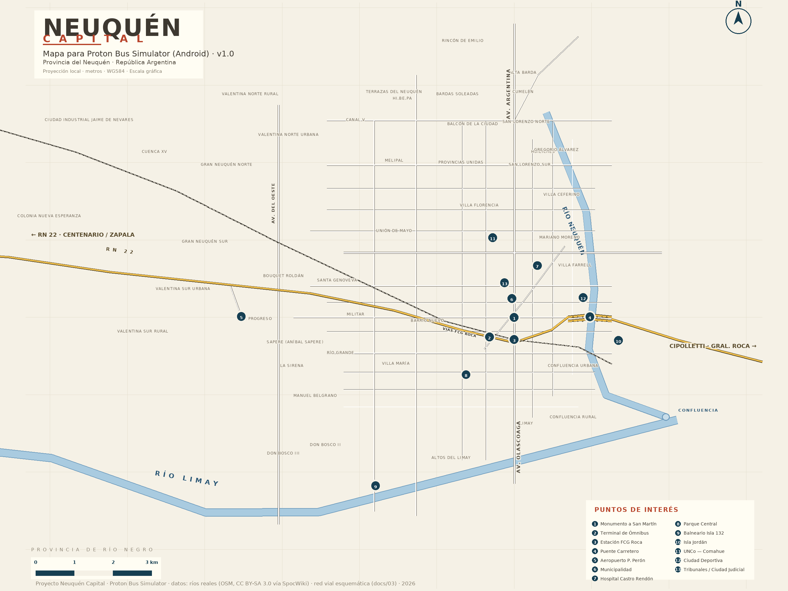
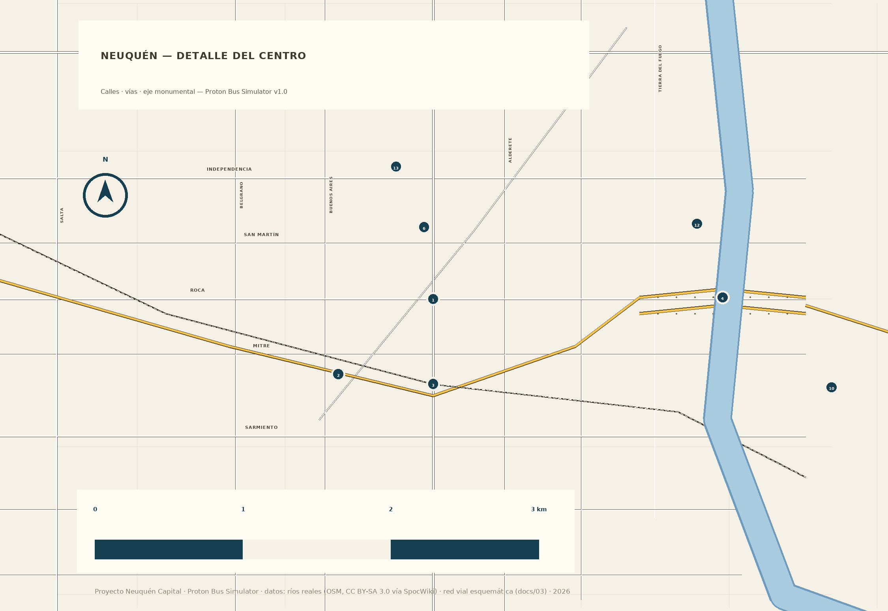
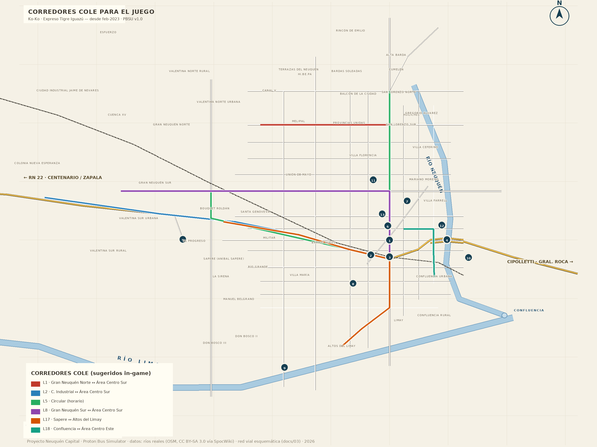
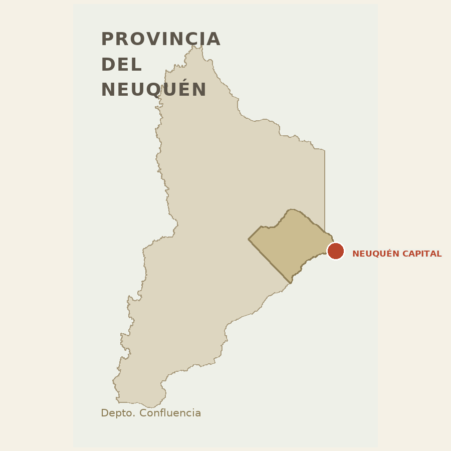

# Neuquén Capital — Mapa para Proton Bus Simulator


> Proyecto completo y documentado para llevar la **Ciudad de Neuquén**
> (capital de la provincia del Neuquén, Patagonia argentina) como mapa del
> juego **Proton Bus Simulator** para Android. Incluye relevamiento real de la
> ciudad, 30 líneas COLE, 50 barrios, geometría de los ríos Limay–Neuquén–Negro,
> mapas cartográficos, modelo 3D esquemático y paquete distribuible.
>
> ⚠️ **Estado honesto**: este repositorio contiene la **fuente completa** y la
> documentación para compilar/transportar el mapa al juego. El formato binario
> interno de PBSU es propietario y no está documentado públicamente; el archivo
> jugable final requiere las herramientas descriptas en
> [`docs/02-FORMATO-PBS-Y-PBS-MAP-STUDIO.md`](docs/02-FORMATO-PBS-Y-PBS-MAP-STUDIO.md)
> y [`docs/04-DISENO-EN-JUEGO.md`](docs/04-DISENO-EN-JUEGO.md). No lo publicamos
> como "probado en juego" hasta que lo esté.

## Qué incluye

| Parte | Archivo(s) | Detalle |
|---|---|---|
| Mapa general | `maps/neuquen-capital-mapa.{svg,png}` | Ciudad completa, ejes, ríos, RN 22, puente, barda, 13 POIs, barrios |
| Detalle del centro | `maps/neuquen-centro-detalle.{svg,png}` | Eje Argentina/Olascoaga, centro cívico, landmarks, ríos |
| Corredores COLE | `maps/neuquen-rutas-cole.{svg,png}` | L1, L2, L5, L8, L17, L18 como vías jugables |
| Inset provincial | `maps/neuquen-provincia-inset.{svg,png}` | Ubicación de la ciudad y la cuenca Limay–Negro |
| Modelo 3D | `3d/NeuquenCapital.obj` + `.mtl` | Terreno, agua, vialidad, Parque Central, 144 edificios, landmarks |
| Datos | `data/*.json`, `data/geo/` | Red vial, barrios, POIs, 30 líneas COLE, ríos (OSM) |
| Paquete | `dist/NeuquenCapital_PBSU_v1.0.0.zip` | Todo lo anterior + LEEME y manifiesto SHA-256 |
| Docs | `docs/00..05` | Alcance, instalación Android, formato, ficha real, diseño en juego, desarrollo |

## Vista previa

| | |
|---|---|
|  |  |
|  |  |

## Inicio rápido

```bash
python3 -m venv .venv && . .venv/bin/activate   # opcional
pip install pillow
python3 tools/render_map.py    # regenerar mapas
python3 tools/build_3d.py      # regenerar modelo 3D
python3 tools/build_mod.py     # regenerar el paquete dist/*.zip
python3 tools/validate.py      # verificación integral
```

Requisitos: Python 3.10+ (y Pillow solo para los PNG). Nada más.

## Datos y precisión

- **Ríos y límites**: geometría real (OpenStreetMap vía
  [SpocWiki/America-Argentina](https://github.com/SpocWiki/America-Argentina),
  CC BY-SA 3.0).
- **Red vial, POIs `approx`, barrios**: **esquemáticos**, ±100–800 m
  (topología real, posición aproximada). Ver tabla de fuentes en
  [`docs/05-DESARROLLO.md`](docs/05-DESARROLLO.md#3--fuentes-de-datos-y-licencias-resumen)
  y registro legible por máquinas en [`data/sources.json`](data/sources.json).

## Documentación

- [00 · Alcance](docs/00-ALCANCE.md) — qué es y qué no es (todavía)
- [01 · Instalación en Android](docs/01-INSTALACION-ANDROID.md)
- [02 · Formato PBS y PBS Map Studio](docs/02-FORMATO-PBS-Y-PBS-MAP-STUDIO.md)
- [03 · Ficha real de Neuquén](docs/03-MAPA-REAL-NEUQUEN.md) — COLE, barrios, POIs, infraestructura
- [04 · Diseño en el juego](docs/04-DISENO-EN-JUEGO.md) — fases, paradas, corredores, performance Android, QA
- [05 · Desarrollo](docs/05-DESARROLLO.md) — pipeline, fuentes, roadmap OSM/SRTM

## Créditos y licencia

- Datos geográficos de ríos y límites: © OpenStreetMap contributors (ODbL 1.0)
  vía SpocWiki/America-Argentina (CC BY-SA 3.0).
- Resto: elaboración propia + fuentes citadas; redacción CC BY-SA 3.0.
- Carátula: generada con IA (ilustrativa, no fotografía real).

**CC BY-SA 3.0** — podés compartir y adaptar, incluso comercialmente, con
atribución y la misma licencia. Ver [`NOTICE.md`](NOTICE.md) para atribución
completa y avisos de no afiliación.

No afiliado a ViaMep / Proton Bus Simulator, a la Municipalidad de Neuquén, a
Vialidad Nacional, a Ko-Ko S.R.L. ni a Expreso Tigre Iguazú. Las marcas
pertenecen a sus titulares.
